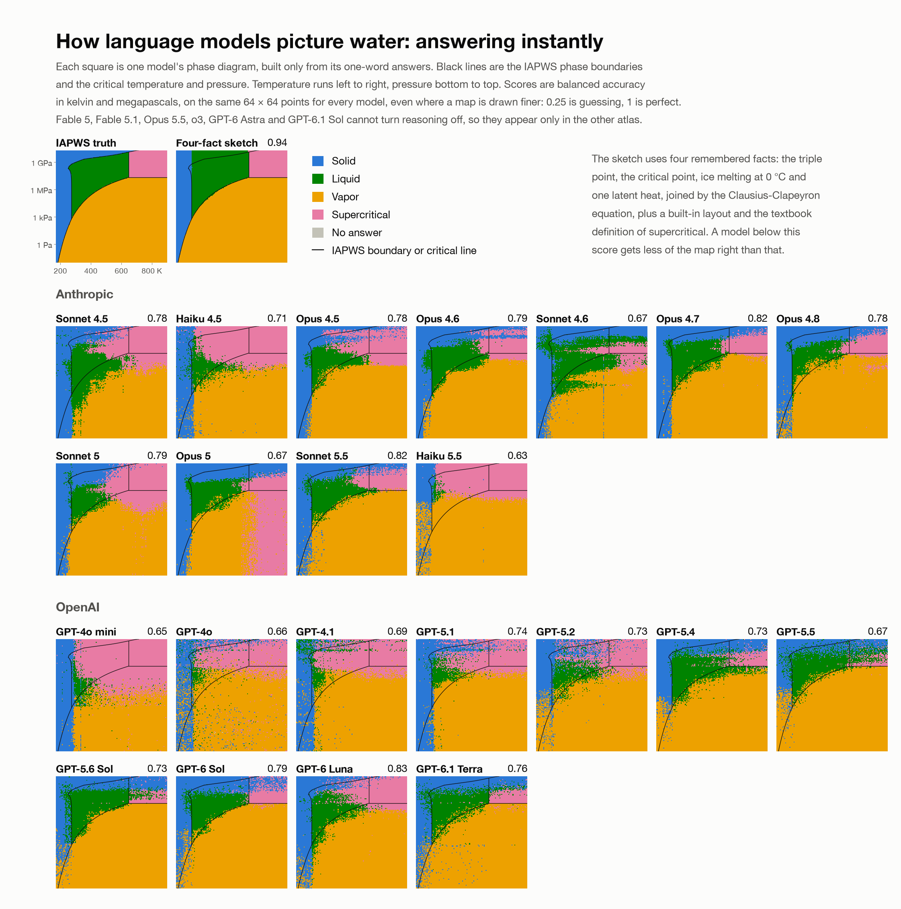
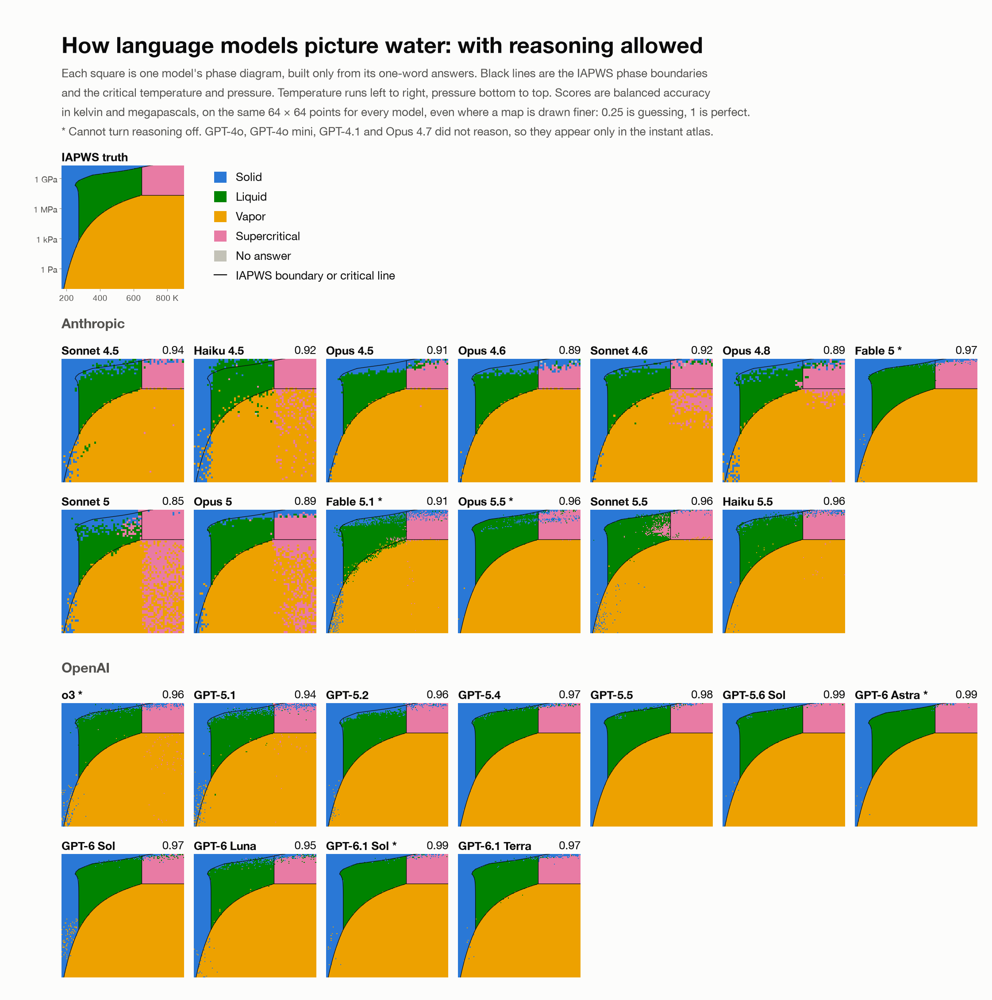
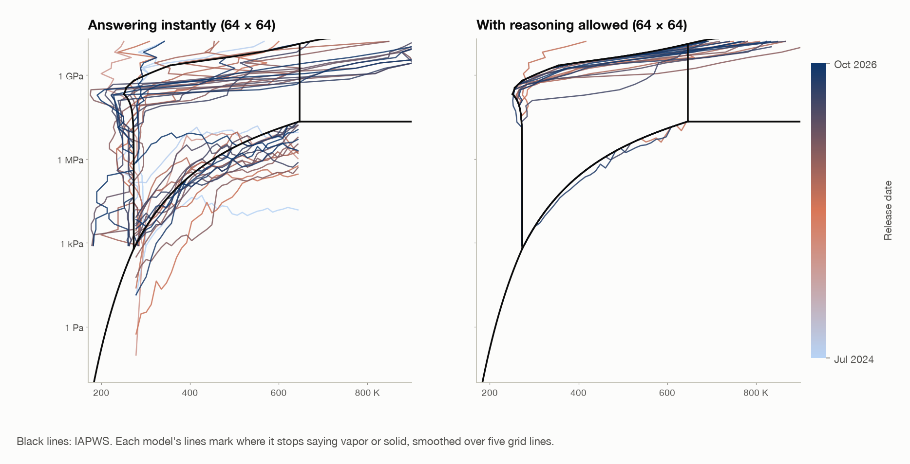
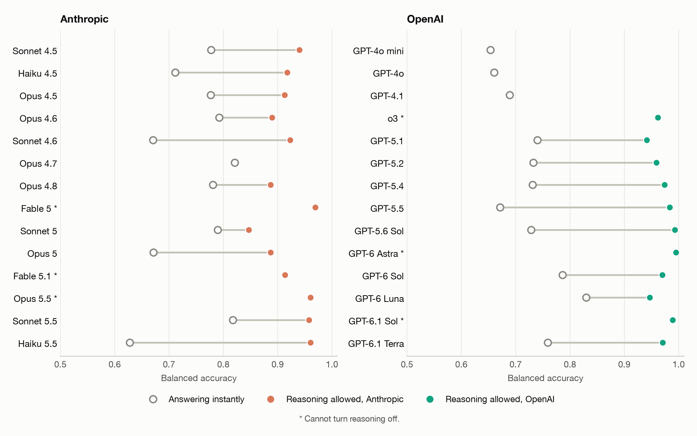
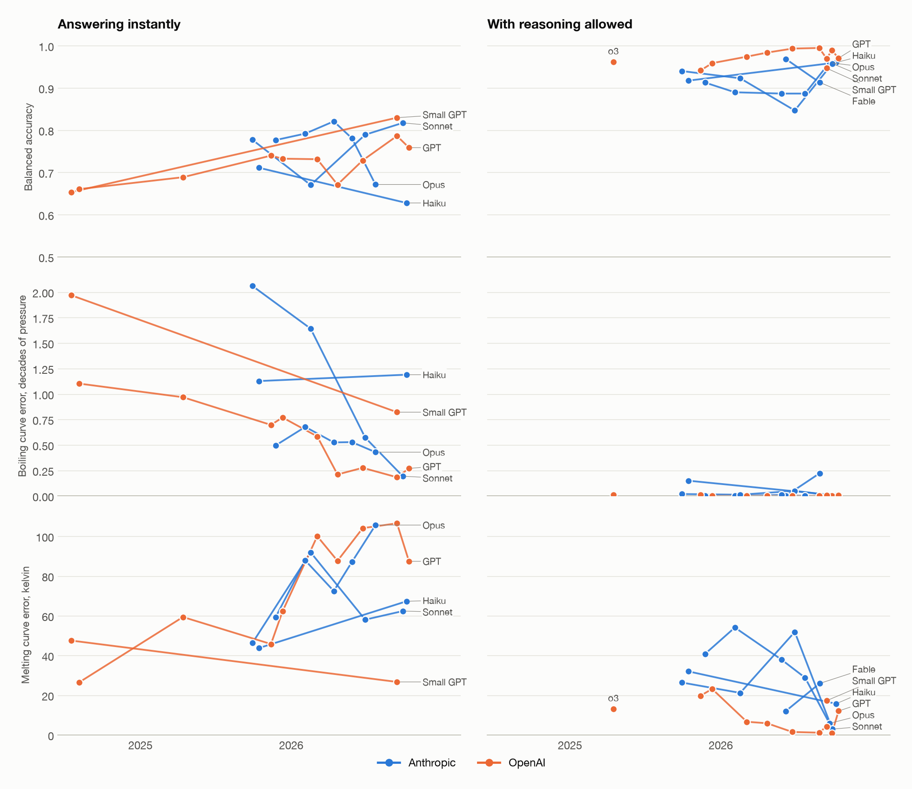
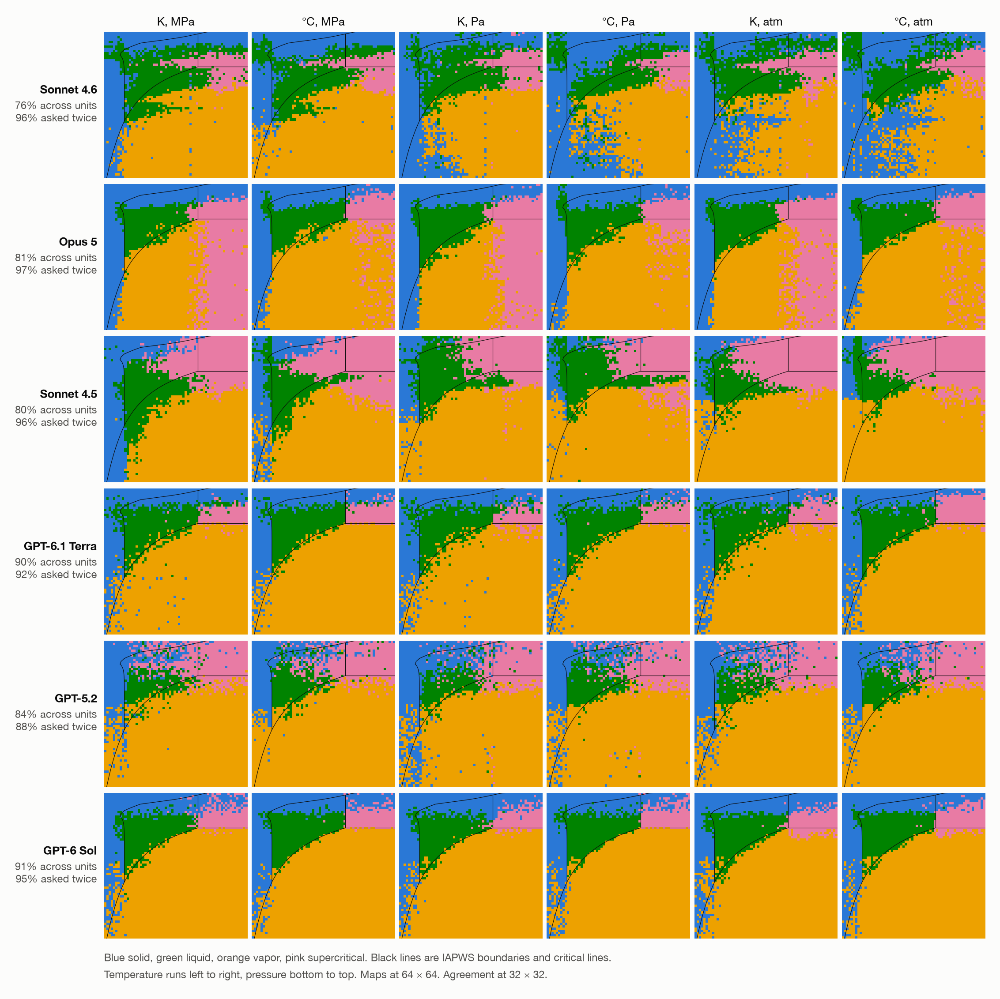
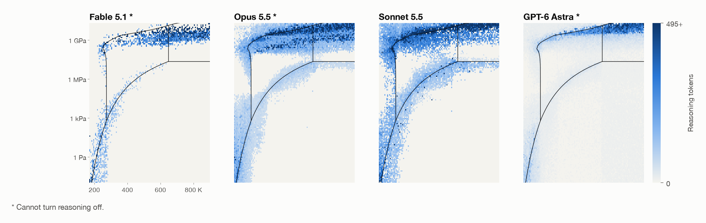

# What does a language model think water does?

This repository asks 28 models from Anthropic and OpenAI about water at thousands of
temperatures and pressures, grades the phase diagram each one implies against the IAPWS
reference equations, and repeats the same conditions in six sets of units. The method follows
[How does a blind model see the Earth?](https://outsidetext.substack.com/p/how-does-a-blind-model-see-the-earth)
by henry.

**[Interactive results](https://kiankyars.github.io/phase-diagram/)**





## What the maps show

Answering instantly, the models draw maps that look like phase diagrams, but none beats a
sketch made from four remembered facts. Allowed to reason, half of the 18 models tested
both ways beat it, the best are almost exact, and newer models are not clearly more
accurate.

Scores are balanced accuracy in kelvin and megapascals on the same 64 × 64 points: 0.25 is
guessing and 1 is perfect. A trend is clear when the 95% bootstrap interval on its yearly
change does not include zero.

**Tidy is not the same as right.** On instant maps 84–98% of points sit in the largest
connected region of their phase, yet balanced accuracy is only 0.63 to 0.83. The big
misses are liquid above the critical pressure (68% wrong) and vapor below 0 °C (56%).

**Four facts beat every instant map.** A sketch built from the triple point, the critical
point, ice melting at 0 °C and one latent heat scores 0.94. No model answering instantly passes 0.83 in these units.
The sketch's layout does not follow from the four facts, and it was chosen after a small trial run. It has no ice above 0 °C, so 21 of the 22 instant maps beat it on high-pressure ice.

**OpenAI's boiling curve improved, and its melting curve overshot.** OpenAI's instant
boiling error fell from about 2 decades of pressure on GPT-4o mini to about 0.2 on GPT-5.5
and GPT-6 Sol. One decade is a factor of 10. That fall is clear over OpenAI's full history
but not since September 2025, the period both providers cover. Anthropic shows no clear
trend in this error. Melting curve error did not fall. Above 209 MPa, the melting curves of OpenAI's three oldest models sit 46–193 K too cold, and those of its models from GPT-5.4 on sit 65–351 K too hot. Thirteen of the 22 instant models turn hot compressed liquid into ice below 1 GPa. At those temperatures the true melting pressure is 3 to 12 GPa.



**Allowing reasoning improved all 18 models tested both ways.** Balanced accuracy rose by
a median of 0.20 and at least 0.06. Median melting error fell from 77 K to 20 K and boiling
error from 0.58 to 0.006 decades. The melting curves of GPT-5.6 Sol, GPT-6 Astra and
GPT-6.1 Sol match IAPWS at all but one or two of 39 pressures.





**Instant answers depend on the units.** At 32 × 32, all 22 instant models change their answers more
when the units change than on a plain repeat. Sonnet 4.6 agrees with itself on 96%
of repeats and 76% of unit changes. Opus 5 calls hot gas below the critical pressure
supercritical 85–89% of the time in kelvin and 18–22% in Celsius. With reasoning allowed, at 16 × 16, the gap between repeats and unit changes is 0.06 at most.



**Models reason most near the boundaries.** Nine models often skip reasoning. Eight of them reason more often near a boundary or critical line, and all nine spend more tokens there. Opus 5.5 reasons on 79% of nearby points and 20% of the rest,
Sonnet 5.5 on 76% and 17%.



## How it works

| Step | What happens |
|---|---|
| Grid | One randomly placed point per cell, from 16 × 16 up to 128 × 128, over 170–900 K and 0.01 Pa to 20 GPa. Points within 2 K or 0.03 decades of a boundary or critical line are redrawn in the same cell |
| Prompt | `Pure water at equilibrium, at 450.00 kelvin and 2.000 megapascals: solid, liquid, vapor, or supercritical? Do not say anything else.` One user message and no system prompt, though Anthropic adds one describing the schema |
| Units | Six sets, K or °C with Pa, MPa or atm. Two are asked twice to measure noise |
| Sandbox | The request code accepts a fixed list of keys, none of which can carry a tool, and raises on anything else. A provider-enforced schema limits replies to the four phase words |
| Conditions | Instant (no reasoning) and reasoning allowed, called `reasoned` in the results tables. The six models that cannot turn reasoning off sit in arm `direct` in `data/answers`. Allowed is not the same as used: see `share_thought` |
| Truth | [IAPWS R14-08](https://iapws.org/technical-guidance/release/MeltSub) for melting and sublimation and the Wagner and Pruss saturation equation from [IAPWS SR1-86(1992)](https://iapws.org/technical-guidance/release/Supp-sat). Supercritical means above both the critical temperature and pressure |
| Scoring | Balanced accuracy averages the four phases, because 61% of the grid counts as vapor. Boundary error is the mean absolute offset from the true boundary, over 33 temperatures for boiling and 39 pressures for melting |
| Tier | Batch at both providers, and OpenAI's Flex tier, at the same price, for seven models |

[`PLAN.md`](PLAN.md) has the design decisions and the budget.

## Reproduce

Grading needs no API keys. It reads the answers stored in `data/`.

```bash
uv sync
uv run pytest -q
uv run python -W ignore scripts/grade_models.py
uv run python -W ignore scripts/make_figures.py
uv run python -W ignore scripts/build_site.py
uv run python -W ignore scripts/claims.py
uv run python -W ignore scripts/budget.py
```

`claims.py` recomputes the numbers quoted on the page and here into `results/claims.json`.

To change the page, edit [`site/page.md`](site/page.md), run `build_site.py`, and push.

Asking again spends real money and needs `ANTHROPIC_API_KEY` and `OPENAI_API_KEY` in
`~/.env`. A run never repeats a question that already has an answer, so clear `data/answers` and `data/batches` first. Retired models may no longer answer.

```bash
uv run python -W ignore scripts/run_wave.py pilot units core retest detail --provider anthropic
```

The original run also used `--models`, `--cap` and `--flex`, so these commands alone will
not match it exactly.

## Repository map

| Path | Contents |
|---|---|
| `src/phase_diagram/truth.py` | IAPWS curves and the true phase of any point |
| `src/phase_diagram/grid.py` | The nested grid of randomly placed points |
| `src/phase_diagram/framings.py` | The six sets of units and the prompt |
| `src/phase_diagram/sealed.py` | The allowlists that keep tools out |
| `src/phase_diagram/registry.py` | Models, prices and reasoning settings |
| `src/phase_diagram/pipeline.py` | Batch and Flex runs, caps, storage |
| `src/phase_diagram/grade.py` | Every score |
| `src/phase_diagram/figures.py` | The static figures |
| `scripts/` | Entry points |
| `site/page.md` | The text of the results page, with one `{{name}}` line for each chart |
| `site/widgets.html` | The charts and controls that those lines stand for |
| `site/template.html` | The page styles and scripts |
| `.github/workflows/pages.yml` | Publishes `results/site/` to GitHub Pages |
| `data/answers/` | One folder per model, one parquet per batch |
| `data/raw/` | The raw replies, gzipped, one file per batch |
| `data/batches/` | One manifest per batch |
| `results/` | Scores as CSV, `claims.json`, figures, and the built page |

## Limits

- Model retirements cut Anthropic's history off at September 2025 and OpenAI's at July 2024, so the two providers cover different periods. Release date stands in for generation.
- Six models cannot turn reasoning off: Fable 5, Fable 5.1, Opus 5.5, o3, GPT-6 Astra and
  GPT-6.1 Sol. They count only as reasoning allowed. GPT-4o, GPT-4o mini, GPT-4.1 and
  Opus 4.7 are instant only.
- Reasoning settings differ between models, and newer models reason less at both
  providers. So a trend with reasoning allowed may reflect how much a model reasons, not
  how new it is.
- Changing the unit can also change how a number is written, so a gap between sets of
  units is not purely a unit effect.
- Intervals are not adjusted for the number of tests: 26 of 143 trends and 13 of 84 unit
  comparisons exclude zero. Intervals also come from resampling models, and consecutive releases are related, so an interval just clear of zero is weak evidence.
- The critical lines around supercritical are a naming convention. Accepting the word for all fluid lifts the best instant score from 0.83 to 0.92, and the sketch still leads at 0.94. But accepting it also hides ordinary liquid a map is missing.
- Ice VII above the critical temperature is barely sampled.
- Six GPT-6.1 Terra answers have no raw reply because of an ID collision, which is now
  fixed.
- The code, the analysis and this text were written with Claude Code running Claude
  Opus 5.5, which is one of the graded models.
- `data/` holds model outputs kept as a research record, many of them wrong. They are not
  offered as training data.
- Default sampling applies throughout, and each prompt is asked once or twice.

## Cost

The run cost $796: $462 at Anthropic and $334 at OpenAI, at Batch or Flex prices. The most expensive model was Fable 5 at $75. `scripts/budget.py` prints the split by model.
